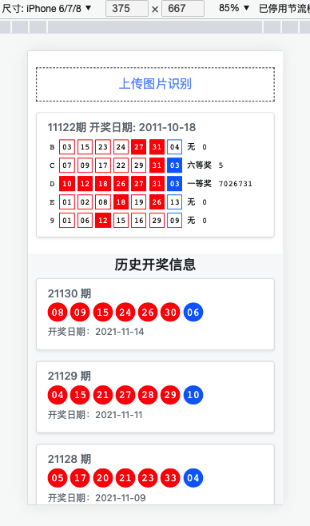

# dream-lottery

### spider_data/ssq.txt 数据字段格式,按逗号分割后顺序为   
|  期号  | 红球1 | 红球2 | 红球3 | 红球4 | 红球5 | 红球6 | 篮球 | 一等奖 | 二等奖 | 开奖日期 |
|  ----  | ----  | ----  | ----  | ----  | ----  | ----  | ----  | ----  | ----  | ----  |
21125 | 14 | 19 | 20 | 23 | 24 | 31 | 09 | 8898474 | 232052 | 2021-11-02
21124 | 01 | 03 | 18 | 22 | 29 | 32 | 02 | 7956250 | 252670 | 2021-10-31

### spider_data/ssq.json 数据格式

与 ssq.txt / ssq.js 同源同步生成，按期号从新到旧排列，便于接口直接返回：

```json
{
  "count": 3525,
  "latest": "26128",
  "updatedAt": "2026-11-10 14:55:30",
  "data": [
    {
      "issue": "26128",
      "red": ["05", "06", "10", "25", "27", "30"],
      "blue": "11",
      "prize1": 10000000,
      "prize2": 175266,
      "date": "2026-11-08"
    }
  ]
}
```

- `issue` 为 5 位期号（与 ssq.txt 一致），红球/蓝球均为字符串，保留前导零
- `prize1` / `prize2` 为一、二等奖单注金额，整数；源端缺失时为 `null`
- `date` 为开奖日期，`count` 为总期数，`latest` 为最新期号

### 数据采集脚本 spider_ssq.py

开奖数据由 `.github/workflows/start_spider_ssq.yml` 定时（每 10 分钟）执行脚本更新。

数据源地址以 base64 常量内置在脚本里，运行时自动解码，因此 workflow 不需要传参、也不依赖 secrets。

三个源的分工（按顺序执行）：

| 参数 | 角色 | 说明 |
| --- | --- | --- |
| `-u` | 主源 | 全量历史（HTML 表格），每次运行 |
| `-u2` | 附加源 | 全量文本，每次运行，只补缺失期号、不覆盖已有行 |
| `-u3` | 最后兜底 | 仅在前两个源都拿不到数据时启用；该源仅中国大陆 IP 可达，GitHub 的美国 runner 上通常用不到 |

需要查看内置的源地址时（零依赖，不装 requests 也能跑）：

```bash
python spider_ssq.py --show-sources
```

临时换源可直接传参，留空即回落到内置源：

```bash
python spider_ssq.py -u "https://.../history.php" -u2 "" -u3 ""
```

### dream-lottery-web
dream-lottery-web 是一个spring boot web服务，拥有查询最新开奖信息和拍照识别中奖功能
页面地址：http://127.0.0.1:8080/ssq/index

OCR图片文字识别集成的百度OCR SDK，百度的OCR个人认证可以领取每个月1000次的免费查询，需要使用到OCR功能需要传入以下3个参数
BAIDU_OCR_APPID="111"
BAIDU_OCR_APPKEY="222"
BAIDU_OCR_SECRET="333"

```
docker 快速启动

docker run --restart=always --name dream-lottery-web -p 8080:8080 -e BAIDU_OCR_APPID="111" -e BAIDU_OCR_APPKEY="222" -e BAIDU_OCR_SECRET="333" midaug/dream-lottery-web:latest
```

#### 效果图
